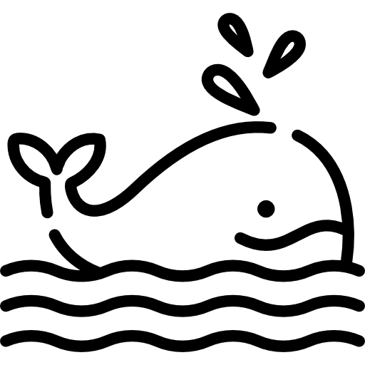

<div align="center">



# Tommys Hermes ACP

**Chat with [Hermes Agent](https://hermes-agent.nousresearch.com) from the VS Code / VSCodium sidebar.**

</div>

---

## What this is

A VS Code / VSCodium extension that runs your local Hermes Agent inside the editor. It spawns
`hermes acp --profile <profile>` as a child process and speaks the
[Agent Client Protocol](https://agentclientprotocol.com) over stdio, rendering the conversation in a
webview chat panel: streaming replies, markdown with syntax highlighting, session tabs, model and
profile switching, tool-call visibility.

**This is Emperor & Fool's fork of [Rina Hermes ACP](https://github.com/jove-rina/rina-hermes-acp)**
(MIT, © 2026 jove-rina), continued under its own extension identity. It is not the upstream project
and is not endorsed by it. Provenance and licence details are in [`NOTICE`](NOTICE); the inherited
MIT notice is retained verbatim in [`LICENSE`](LICENSE).

## What this fork adds on top of upstream 0.3.2

- **Image paste** — screenshots and image files pasted into the composer are read in the webview
  (`ClipboardEvent.clipboardData`), base64-encoded and sent as ACP `image` content blocks. Hermes'
  ACP adapter advertises `promptCapabilities.image = true`, so the agent side needs no change.
- **Image-only send** — a prompt consisting only of images is valid.
- **Inline preview** of sent images inside the user's message bubble.
- **Light-theme readability fix** for assistant bubbles.
- **Live font-size pill** (`Aa`, 10–28 px, persisted under `tommys.chatFontSize`).
- **Input footer layout** — model label, font-size control and token-usage ring no longer overlap in
  a narrow sidebar.

The image work is also proposed upstream as
[PR #8](https://github.com/jove-rina/rina-hermes-acp/pull/8).

## Requirements

- VS Code 1.85+ or VSCodium (this is developed against VSCodium)
- [Hermes Agent](https://hermes-agent.nousresearch.com) installed and configured
- `hermes` on `PATH`, or `tommys.path` set in settings

## Build and install

```bash
npm install
npm run compile
npx @vscode/vsce package --no-yarn -o tommys-hermes-acp-1.0.0.vsix
codium --install-extension "$PWD/tommys-hermes-acp-1.0.0.vsix" --force
```

Extension id: `emperorandfool.tommys-hermes-acp` — distinct from upstream's
`joverina.rina-hermes-acp`, so both can be installed without the duplicate-id load problem.

## Use

1. Click the **Hermes Agent** icon in the activity bar, or run **Tommys: Open Chat** from the
   command palette.
2. Wait for status **Ready**, then type. **Enter** sends, **Shift+Enter** adds a line.
3. `@` references a workspace file; clicking a path in a reply opens it in the editor.
4. **+ New** starts a conversation; tabs keep local history.

> Switching sessions resets the agent's in-memory context. Saved messages are restored locally and
> marked as local history — Hermes does not replay prior context unless the client restores the
> session over ACP (`session/load`), which this build does not yet do.

## Settings

| Setting | Description | Default |
|---|---|---|
| `tommys.path` | Path to the Hermes executable | auto-detect |
| `tommys.cwd` | Working directory for sessions | workspace root |
| `tommys.profile` | Hermes profile name | `default` |
| `tommys.showThoughts` | Show agent reasoning | `false` |
| `tommys.showToolCalls` | Show tool-call notifications | `false` |
| `tommys.contextAttachVisibility` | When to offer session-memory attach | `onNewSession` |
| `tommys.models` | Fallback model list | `[]` |
| `tommys.defaultModel` | Default model id (fallback list only) | `""` |
| `tommys.agents` | Named agent configurations | `[]` |

```json
"tommys.agents": [
  { "name": "Default", "profile": "" },
  { "name": "Fast", "path": "/path/to/hermes", "profile": "fast" }
]
```

## Troubleshooting

| Symptom | What to try |
|---|---|
| Stuck on **Connecting…** | Wrench menu → Environment detection; ensure `hermes` is on PATH or set `tommys.path` |
| **ACP dependencies missing** | Run `hermes acp --check` in a terminal |
| No reply on the first message | Normal — Hermes may load plugins on first turn |
| Model not listed | Add entries under `tommys.models` |

## Licence and attribution

**This project is distributed under GPL-3.0-or-later**, © 2026 Emperor & Fool — full text in
[`LICENSE`](LICENSE). It is a fork of Rina Hermes ACP, which was received under the **MIT**
licence, © 2026 jove-rina; that notice is retained verbatim in
[`LICENSES/MIT-jove-rina.txt`](LICENSES/MIT-jove-rina.txt) as MIT requires, and the upstream code
remains available from upstream under MIT. The full split, the upstream commits this fork is based
on, and the bundled third-party licences are in [`NOTICE`](NOTICE) and
[`packaging/copyright`](packaging/copyright).

Because this is a GPL work: the complete source for every distributed build is this repository, and
anyone redistributing a modified version must do so under the same licence.

Bundled components keep their own licences: `@agentclientprotocol/sdk` and `media/vendor/purify.min.js`
(DOMPurify) Apache-2.0; `media/vendor/highlight.min.js` and `github-dark.min.css` (highlight.js)
BSD-3-Clause; `media/vendor/marked.min.js` MIT.

Neither MIT nor the GPL grant trademark rights: the upstream name "Rina Hermes ACP", the
`jove-rina` name and the upstream marketplace identity are not used by this fork. The icon and
activity-bar glyph under `media/` are still upstream artwork — redistributable, but they are not
Emperor & Fool branding and are being replaced.
