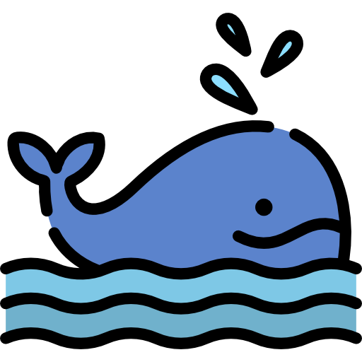
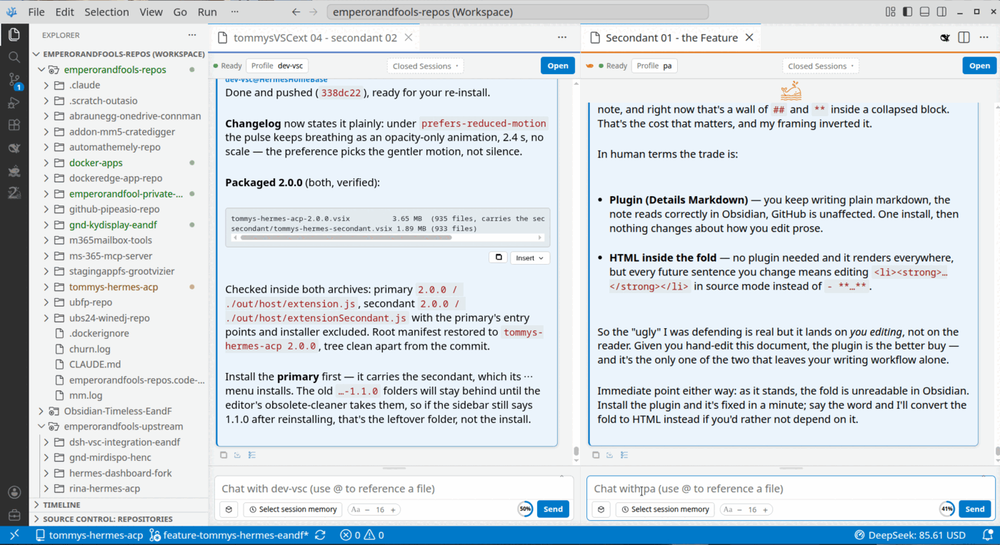

    <h1>Tommys Hermes ACP 2.0</h1> 
<strong><a href="https://hermes-agent.nousresearch.com">Hermes</a> in your editor, with the three moves you won't find in most agent clients: steer a run while it is running, pull context out of any of your other conversations, and run a second independent agent beside the first.</strong>
 

---

> **TL;DR** — Two Hermes agents in one editor window, on separate profiles.
> Steer a run while it runs. Pull context from any of your sessions.
> The panes allows agents to hand each other work, with you as the gate.

## What this is

A VS Code / VSCodium extension that runs your local
[Hermes Agent](https://hermes-agent.nousresearch.com) inside the editor. It spawns
`hermes acp --profile <profile>` and speaks the
[Agent Client Protocol](https://agentclientprotocol.com) over stdio, so the agent you
already trust is the one doing the work. 

The extension *is* the [Hermes](https://hermes-agent.nousresearch.com) client. All credits to the people on the Hermes project. Without them we would not have such great co-operation with Agents. Without them I would not have had this great profit of the 'lesser' models, now performing at the level of the Frontier corporate Big Tech.

A secondary agent can now be installed from the primary extension's menu. A premium feature for free. In the same VSCodium in its own panel or each in their editor panel's tab they run side-by-side. Different profile, different session, different transcript, even a different model if you want. You tab between them for single tab view, or place them side by side for full conversation overview. 

Personally I like the primary agent to be specialized on the current mission; the secondant should research, drafts prompts and tracks the project with an overview. You can have them send messages directly between them if you like. Guarded by your click.

'Secondant' is Dutch for the 'second' in a classic wing-man relationship when challenged. A fencer's _second_ stands beside the duellist as an equal with a different role. 

That's the shape of this: two agents, their challenge, your call.

Enjoy the game!

Thomas Kai Tchong

<strong>Read more — what the two agents do</strong>

<h2>Two agents in one window</h2>

Install the companion from the primary's menu <strong>Install secondant</strong>. A second, independent
agent appears. One install for you, two extensions on disk, nothing to configure twice.

<ul>
<li><strong>They cannot share a profile.</strong> Pointed at the profile the primary is using, the
secondant drops its connection, opens its picker and says why. Two agents means two
profiles, enforced rather than hoped for.</li>
<li><strong>You can tell them apart at a glance.</strong> The secondant carries an orange rule across its
toolbar and a badge row beneath it; in the editor-panel surface each pane's frame is
drawn in its own accent.</li>
<li><strong>They can hand each other work.</strong> Forward any message from one pane to the other: it
arrives as a card with a sender pill and its body rendered as markdown, and nothing
reaches the receiving agent until you press <strong>Deliver</strong>. Consecutive forwards stack under
one rail with a single Deliver / Dismiss, sent as one turn in arrival order.</li>
<li><strong>Session memory crosses too.</strong> Forward a slice of any conversation and the receiving
agent gets the session handle, an anchor when no message ids matched, and a note that the
handle reads outside its own profile — along with the call that reads more of it.</li>
</ul>

The channel is a file under your Hermes home. No service, no port, no network: it carries
your own messages under your own permissions, and you sit in the middle of every hop.

<h2>Steer a run while it runs</h2>

With a turn in flight, type into the composer and <strong>Stop becomes Steer</strong>. Your words go
into the turn — not as a new question, not as cancel-and-retry — as guidance the agent
folds into what it is already doing. The transcript marks it with an orange <strong>Steer</strong> tag
that survives reload. The turn keeps its identity, its tool calls, its context.

It is the one workflow difference you will feel every day.

<blockquote>

<strong>Roadmap:</strong> time-limited auto-approve while a steered turn runs, so you can say
"go ahead with the next three" without clicking a card for each one.

</blockquote>
<h2>Pull context from another conversation</h2>

Pick any of your other sessions from the composer, read it in a throwaway tab, tick the
messages you want, and they arrive above your prompt as a quoted, attributed block.

<ul>
<li><strong>Anchored, not pasted</strong> — the block points at message ids, so the quote stays faithful
even after the source conversation moves on.</li>
<li><strong>Every session Hermes knows</strong> — the viewer reads from Hermes rather than from a local
copy, so a conversation you had in the TUI can be opened in our primary or secondant extension in two clicks.</li>
<li><strong>A pick belongs to its tab</strong> — context you staged for one thread cannot leak into
another. The current session is also offered: after a model switch the agent has lost
its context, and this tab's own earlier messages are exactly the memory worth
re-attaching.</li>
<li><strong>Choose the depth</strong> — a role filter on the attach bar lets you toggle User, Assistant,
Thought and Tool messages, so you can carry a question and its answer without dragging
forty tool calls along, or include the reasoning when you need it.</li>
</ul>
<h2>The rest of the client</h2>

Sidebar or editor pane, your choice · tabs with rename and reopen · streaming markdown
with syntax highlighting · image paste and image-only prompts · <code>@</code> file mentions ·
send the editor selection as a prompt · transcript search, in the chat and in the viewer ·
multi-select copy, delete and export · session export as markdown · token meter · log
viewer · environment detection that finds a Hermes install and repairs <code>PATH</code> itself ·
English and Simplified Chinese throughout, including Hermes' own permission wording.

<h2>Quieter touches</h2>
<ul>
<li><strong>Approvals carry their own mode switch</strong> — Manual · Smart · Off on the pending card,
written through to the profile and applied to every other waiting card.</li>
<li><strong>The agent's structured questions render as forms</strong>, not as dead prompts.</li>
<li><strong>Consecutive tool calls fold into one card</strong>, so a dozen reads do not bury the answer.</li>
<li><strong>Thoughts and tool cards grow with the text while live</strong>, then collapse to a readable
cap when the turn finishes — so you can follow reasoning as it arrives without it
pushing the answer off-screen afterwards.</li>
<li><strong>Loading looks deliberate</strong> — the pane's own icon, pulsing, with a live count of the
messages arriving from Hermes beneath it.</li>
<li><strong>A message Hermes never received is caught</strong> — the last few user turns live in a small
sidecar, and the agent's replay is checked against it before the transcript is replaced.</li>
</ul>

## Who this is for

Not people shopping for an AI assistant in the abstract. People who have already chosen
Hermes, work across more than one conversation at a time, and want the
editing-while-it-runs rhythm that most clients make you fight for.

<strong>Requirements, settings and install</strong>

<h2>Requirements</h2>
<ul>
<li>VS Code 1.85+ or VSCodium (this is developed against VSCodium)</li>
<li><a href="https://hermes-agent.nousresearch.com">Hermes Agent</a> installed and configured</li>
<li><code>hermes</code> on <code>PATH</code>, or <code>tommys.path</code> set in settings</li>
<li>For the secondant: a <strong>second Hermes profile</strong>, because the two panes may not share one</li>
<li>The <strong>Hermes ACP patch</strong>, applied to your Hermes install — see <em>Important: the Hermes patch</em> below. Without it the tab list cannot see hidden sessions, closing a tab leaves it listed, and renames do not stick</li>
</ul>
<h2>Important: the Hermes patch</h2>

<strong>Apply this before anything else.</strong> The extension uses three ACP extension methods that upstream Hermes does not ship yet:

<ul>
<li><code>_session/catalog</code> — every session, hidden ones included, with its hidden flag</li>
<li><code>_session/setHidden</code> — hide or unhide a session, which is what closing a tab does</li>
<li><code>_session/setTitle</code> — rename a session as a user title</li>
</ul>

Without them the sidebar cannot see sessions you have closed, a closed tab stays listed, and renaming a conversation does not survive. They are added by two patches, kept in this repository until they land upstream:

<pre><code class="language-bash">cd ~/.hermes/hermes-agent
git apply --3way /path/to/tommys-hermes-acp/packaging/hermes-patches/0001-acp-session-catalog-hidden-title.patch
git apply --3way /path/to/tommys-hermes-acp/packaging/hermes-patches/0002-acp-gateway-ext-methods.patch
</code></pre>

<code>0001</code> adds the three methods (base <code>0.22.2</code>, and it reads the session table in either layout — <code>source</code> on 0.22.2, <code>created_source</code> on 0.22.5, where <code>source</code> is rewritten to <code>local</code>); <code>0002</code> carries them onto <code>GatewayACPAgent</code>, the class <code>0.22.5</code> actually answers from, because <code>HermesACPAgent</code>&rsquo;s <code>__new__</code> returns one. On <code>0.22.5</code> and later both are required &mdash; <code>0001</code> alone still applies cleanly and changes nothing, which is what makes the failure quiet. They touch only <code>acp_adapter/server.py</code>, <code>acp_adapter/session.py</code> and <code>acp_adapter/gateway_server.py</code>, and only call Hermes&rsquo; own database methods. Re-apply both after any <code>hermes update</code> that drops them; <code>packaging/hermes-patches/CHANGELOG.md</code> records the bases and the symptom when one is missing.

<em>Tested on Ubuntu 24.04. Windows is untested &mdash; both the Hermes install location and <code>git apply</code> behave differently there. If you try it, please open an issue and say what happened; this section will then state it honestly rather than guess.</em>

<h2>Build and install</h2>
<pre><code class="language-bash">npm install
npm run package                                     # compile + bundle the pane + vsix
codium --install-extension ./tommys-hermes-acp-2.0.0.vsix --force
</code></pre>

<code>npm run package</code> bundles the secondant VSIX inside the primary. <code>npm run package:secondant</code>
builds that companion on its own; users never need it, because the primary installs it from a
command.

<code>npm run deploy</code> is the fast path while developing: it compiles, rebuilds the pane bundle
and copies everything into the installed extension directory, verifying each file by hash.

Extension ids: <code>emperorandfool.tommys-hermes-acp</code> and
<code>emperorandfool.tommys-hermes-secondant</code>.

<h2>Settings</h2>
<table>
<thead>
<tr>
<th>Setting</th>
<th>Description</th>
<th>Default</th>
</tr>
</thead>
<tbody><tr>
<td><code>tommys.path</code></td>
<td>Path to the Hermes executable</td>
<td>auto-detect</td>
</tr>
<tr>
<td><code>tommys.cwd</code></td>
<td>Working directory for sessions</td>
<td>workspace root</td>
</tr>
<tr>
<td><code>tommys.profile</code></td>
<td>Hermes profile name</td>
<td><code>default</code></td>
</tr>
<tr>
<td><code>tommys.showThoughts</code></td>
<td>Show agent reasoning</td>
<td><code>true</code></td>
</tr>
<tr>
<td><code>tommys.showToolCalls</code></td>
<td>Show tool-call notifications</td>
<td><code>true</code></td>
</tr>
<tr>
<td><code>tommys.chatSurface</code></td>
<td><code>sidebar</code> or <code>editor</code></td>
<td><code>sidebar</code></td>
</tr>
<tr>
<td><code>tommys.models</code></td>
<td>Fallback model list</td>
<td><code>[]</code></td>
</tr>
<tr>
<td><code>tommys.defaultModel</code></td>
<td>Default model id (fallback list only)</td>
<td><code>""</code></td>
</tr>
<tr>
<td><code>tommys.agents</code></td>
<td>Named agent configurations</td>
<td><code>[]</code></td>
</tr>
</tbody></table>

The secondant exposes the same keys under <code>tommys2.*</code>.

<pre><code class="language-json">"tommys.agents": [
  { "name": "Default", "profile": "" },
  { "name": "Fast", "path": "/path/to/hermes", "profile": "fast" }
]
</code></pre>

The composer's <code>Aa</code> pill sets the transcript font size (10–28 px) and remembers it.

## Use

1. Click the **Tommys Dev Chat** icon in the activity bar, or run **Hermes: Open Chat**.
2. Wait for status **Ready**, then type. **Enter** sends, **Shift+Enter** adds a line.
3. `@` references a workspace file; clicking a path in a reply opens it in the editor.
4. **+ New** starts a conversation; each tab keeps its own transcript.
5. To steer, keep typing while a turn runs — the button tells you what it will do.
6. For a second agent, run **Install secondant** from the command palette. It appears as a
   second activity-bar container with its own orange accent. **Uninstall secondant** takes
   it out again, version directories included.

> Opening a tab for a session Hermes knows resumes it over ACP (`session/load`), and the
> transcript arrives from Hermes itself — nothing is read back from a local copy.

## Troubleshooting

| Symptom | What to try |
|---|---|
| Stuck on **Connecting…** | Environment menu → detection; ensure `hermes` is on `PATH` or set `tommys.path` |
| **ACP dependencies missing** | Run `hermes acp --check` in a terminal |
| No reply on the first message | Normal — Hermes may load plugins on the first turn |
| Model not listed | Add entries under `tommys.models` |
| An activity-bar icon is missing after an upgrade | Hide, then show the container from the activity-bar context menu |
| Secondant disconnected itself | It is on the primary's profile. Pick another from its profile dropdown |
| Secondant installed but not visible | Reload the window; the registry only lists it after a reload |
| Forward button missing | The other pane is not running — the two panes announce themselves with a heartbeat |
| Need to see what Hermes sends over ACP | Launch the editor with `HERMES_ACP_TRACE=1`; each `session/update` goes to the OutputChannel and to `~/.hermes/pane-mail/trace-<profile>.ndjson` |

## Known issues

- **Approval-mode switch** — the Manual · Smart · Off toggle on permission cards exists
  but has not been tested end-to-end. It may not write through to the profile correctly.
- **Thought segment heuristic** — the pane uses a prefix test to decide whether a thought
  chunk continues the current card or starts a new one. If a genuinely new segment opens
  with the same text as the end of the previous one, it is treated as a continuation.
  Cannot be fixed without the host marking segment boundaries. Very rare in practice.
- **Anchor quotes are truncated** — a forwarded session slice whose message ids did not
  match is anchored on its opening words, clipped at a fixed length. A prefix search finds
  them; a strict search for the whole quote will not.
- **Long transcripts are not virtualised** — every message in a tab is a live DOM node. Fine
  for ordinary sessions, slow on transcripts of several thousand messages.

## FAQ

**Will this be maintained?** The code is split by runtime — `src/host` (VS Code, filesystem,
CLI, ACP), `src/pane` (the webview), `src/shared` (the message contract) — with both
directions of the protocol typed as unions, so a message added on one side fails to compile
on the other. The test suite covers the host side; the pane is bundled by esbuild.

**Is this the upstream project?** No. This project originated from
[Rina Hermes ACP](https://github.com/jove-rina/rina-hermes-acp) (MIT, © 2026 jove-rina)
and continues independently under its own extension identity. It is not endorsed by
upstream. Provenance is in [`NOTICE`](NOTICE).

**Does it work with plain VS Code?** Yes, 1.85 or newer. VSCodium is what it is developed
against.

**What did 2.0 actually change?** Two things that only make sense together. The extension
gained a second, independent agent beside the first, and lost the local copy of the
conversation it had been keeping since the fork. The transcript now comes from Hermes, with
a five-message sidecar for the one case Hermes cannot cover: a message you sent that the
agent never received. See [`CHANGELOG.md`](CHANGELOG.md).

**How far is this from the upstream?** v1.0.0 started with image paste, theming fixes
and a font-size pill on top of upstream 0.3.2. Since then the codebase has been restructured
into host/pane/shared runtimes, the protocol is fully typed, and the features above — the
secondant, pane mail, steer, history attach with role filter, live card sizing, transcript
reconciliation, approval mode switching, elicitation forms, environment detection, i18n —
are all new work. The upstream MIT notice is retained in full; see Licence below.

**Roadmap**

- **Time-limited approve-all** — approve the next N tool calls or approve for the next M
  minutes, so a steered turn doesn't need a click for every step.
- **Virtualised transcripts** — render a window of messages rather than all of them, so a
  session with thousands of turns scrolls as smoothly as a short one.
- **An agent-callable forward** — let an agent propose something for the other pane, with
  the same Deliver gate in front of it.
- **Hermes upstream PR** — contribute the ACP session catalog, hidden and title methods
  back to Hermes as a proper pull request.

## Licence and attribution

**This project is distributed under GPL-3.0-or-later**, © 2026 Emperor & Fool — full text in
[`LICENSE`](LICENSE). It originated from Rina Hermes ACP, received under the **MIT**
licence, © 2026 jove-rina; that notice is retained verbatim in
[`LICENSES/MIT-jove-rina.txt`](LICENSES/MIT-jove-rina.txt) as MIT requires, and the upstream
code remains available from upstream under MIT. The full split, the upstream commits this
fork is based on, and the bundled third-party licences are in [`NOTICE`](NOTICE) and
[`packaging/copyright`](packaging/copyright).

Because this is a GPL work: the complete source for every distributed build is this
repository, and anyone redistributing a modified version must do so under the same licence.

Bundled components keep their own licences: `@agentclientprotocol/sdk` and
`media/vendor/purify.min.js` (DOMPurify) Apache-2.0; `media/vendor/highlight.min.js` and
`github-dark.min.css` (highlight.js) BSD-3-Clause; `media/vendor/marked.min.js` MIT.

Neither MIT nor the GPL grant trademark rights: the upstream name "Rina Hermes ACP", the
`jove-rina` name and the upstream marketplace identity are not used by this project.

**The artwork is not ours, and the GPL does not cover it.** The whale under `media/` —
`icon.png`, `icon.svg`, `icon_fullcolor.png`, `icon_orange.svg`, `icon_SECONDANT.svg` — and
the activity-bar glyph `activitybar.svg` are *designed by Magnific from Flaticon*, used under
the [Flaticon Free License](https://media.flaticon.com/license/license.pdf). That licence
requires attribution, permits recolouring and derivative works, and does not permit
sublicensing or redistributing the artwork on its own. So it is excluded from the GPL grant
above: you may redistribute this extension, not the artwork separately, and you may not
relicense it.
