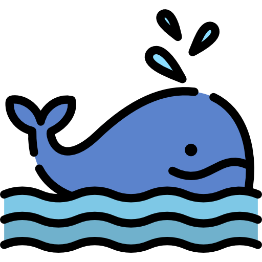
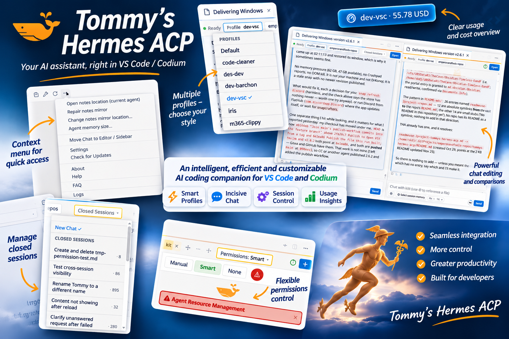

<div align="center">  <br /> <h1>Tommys Hermes ACP</h1> <p><strong><a href="https://hermes-agent.nousresearch.com">Hermes</a> in your code editor. With consistent awareness of the projects you work on. Pull messages from any session into your current prompt. Keep your tabs in projects and move them between workspaces. View two agents per window. Have them exchange messages with you as the gate between them. Install extras from the three-dot menu.</strong></p> </div>

---

> **TL;DR** — Native dual Hermes sessions/chats, organized per agent per project. Set up a Hermes agent, then add the dashboard system tray and a secondary chat panel from inside Tommys Hermes. Add an agent profile through the dashboard (bot in Hermes Desktop) and open it in the secondary chat. You will have an extended workspace available for your agents. Ask your agents if they can find the notes location. You can mirror the files that agents can use to extend long-term memory. Use Obsidian, e.g., to help the agents helping you with your coding projects. Project folders that group your tabs and keep agents project aware, reply buttons on messages to have your agents talk to each other, and you can steer a run by mid-turn messages.

## What this is

A VS Code / VSCodium extension that runs your local [Hermes Agent](https://hermes-agent.nousresearch.com/) inside the editor. It spawns `hermes acp --profile <profile>` and speaks the [Agent Client Protocol](https://agentclientprotocol.com/) over stdio, so the agent you already trust is the one doing the work.

The extension _is_ the Hermes client. All credit to the people on the Hermes project — without them there would be no co-operation with agents like this, and I would not have seen the 'lesser' models perform at the level the frontier corporate labs charge for.

Hermes keeps every conversation you have ever had with it, in whatever surface you had it. This extension reads them all. Pick a session from the composer, tick the messages that matter, and they arrive above your prompt as a quoted block — a conversation from the TUI, from the dashboard, from the other pane. Your tabs sit in named projects that stay out of the way until you switch into them.

A second agent can be installed from the primary extension's menu. A premium feature for free. In the same VSCodium, each in its own panel or its own editor tab, they run side by side — different profile, different session, different transcript, even a different model if you want. You tab between them for a single view, or place them side by side for the full picture.

Personally I like the primary agent specialised on the current mission; the secondant researches, drafts prompts and tracks the project with an overview. They can send messages to each other if you like. Guarded by your click.

'Secondant' is Dutch (and French) for the 'second' in a classic wing-man relationship when challenged. A fencer's _second_ stands beside the duellist as an equal with a different role.

That's the shape of this: two agents, their challenge, your call.

Enjoy the game!

Thomas Kai Tchong

 <details> <summary><strong>Read more — what the extension does</strong></summary>


## Know what it costs

See your provider balance per agent, including whether peak or off-peak pricing applies right now. Click to refresh. DeepSeek for now; the code is ready for more providers.

## Bring what was said elsewhere into your current chat

Every conversation you had with Hermes — in the TUI, the dashboard, a messaging bot or the other pane — is one click away. Open one with **Select session memory**, tick the messages that matter, and they appear above your prompt in a new message card. Selecting a few lines in any message and pressing **Reply** works as you would expect.

- Each quote keeps a link to its source, so the agent can read further on its own.
- Choose which message types come along: user, assistant, thinking, tools.
- The conversation card shows who said what, and in which chat.

## Projects, chats, workspace

Group your tabs in projects. Click a project to make it active; new chats open there. The tree keeps two projects open — the one you work in and the one before — and comes back as you left it after a reload. Ctrl-click to peek into another. **Make It Sticky** pins a tab on top. Move tabs to another workspace from the tab menu.

Your agents see how your work is organised: each agent's folder holds a map of your projects and tabs.

## Notes that outlast the chat

Every agent has a notes folder for extended, long-term, strategic memory outside of Hermes defaults. The agents know and are reminded of their 'personal' file location. Decisions, project facts, how a job was done. Non of it needs to clutter the Hermes-side agent setup. 

Mirror all notes folders into Obsidian or any folder or editor you like. You can set and relocate your local directory to read from, using the three-dot menu. **Agent memory size** in that menu shows how full an agent's Hermes memory is and lets you raise the limit.

## Two agents side by side

Install the secondant from the three-dot menu and run a second agent next to the first: its own profile, its own chats, its own model if you like. A clear visual distinction between the blue primary and the orange secondant chat. Each agent can only run in one chat at a time, across your open windows.

Forward any message to the other chat. It arrives as a card; take your time to think things over and decide: **Deliver** or **Dismiss**. Forward a quote from another conversation and the receiving agent finds the original session and its context.

Everything travels through files on your own machine.

## Hermes in your system tray

Install the **Dashboard** from the three-dot menu and a Hermes icon appears in the tray, on Linux and Windows. It shows whether the server runs, opens the dashboard in its own window, and starts the dashboard when you log in without opening your browser. The installer shows what you have installed and what it needs to download. Uninstall removes exactly what was added.

We chose the dashboard as the back-end GUI. Hermes' own Desktop app remains available as a stand-alone chat app.

## Steer a running job

Type while the agent works and Stop becomes **Steer**: your words join the job in progress and the agent can reply and adjust course when needed. Steered messages carry an orange tag.

## Permissions

The toolbar shows the Hermes permission mode, color-coded and fetched from the Hermes server, so it is accurate at all times.

- **Manual** (blue) asks for every command and every file edit.
- **Smart** (green) lets a secondary agent judge edge-case permission requests. It allows edits inside the workspace's primary directory, the Hermes "current working directory" (cwd).
- You can view and switch which workspace folder is the cwd (primary) from a fly-out menu.
- **None** (orange) runs commands freely and allows writes inside the primary session folder. Allow and deny policies you have set in Hermes still apply.
- **ALL** (red) allows access beyond your self-set policies. They are removed, and restored with one click.

Sensitive files — `.git`, `.ssh`, `.env`, keys — always ask. **Allow for session** on a flagged command covers it for the rest of the chat. When Smart lets a command through, the card that follows tells you why.

A sum of the best Hermes has to offer, in a functional overview.

## And the rest

Sidebar or editor tab · rename, close and reopen tabs from Closed Sessions · streaming markdown with code coloring · paste images · `@` file mentions · send your editor selection · search in every chat · copy and export messages · tool calls grouped in one card · thinking shown live, folded when done · a message lost on the way is offered back · token meter · log viewer · finds your Hermes install and fixes PATH · resizable composer · interface in English and Simplified Chinese.

</details>

## Who this is for

People who have already chosen Hermes, work across more than one conversation at a time, and want the editing-while-it-runs rhythm that most clients make you fight for.

<details> <summary><strong>Requirements, settings and install</strong></summary>

## Requirements

- VS Code 1.85+ or VSCodium (developed against VSCodium)
- [Hermes Agent](https://hermes-agent.nousresearch.com/docs/getting-started/installation) installed and configured
- `hermes` on `PATH`, or `tommys.path` set in settings
- For the secondant: a second Hermes profile — each agent runs in one chat at a time
- For the Dashboard in the tray: Linux or Windows; the installer checks and downloads what it needs
- The **Hermes ACP patch** for your Hermes version — the extension checks it when it connects and offers to apply it

## The Hermes patch

The extension uses three ACP methods that upstream Hermes does not ship yet:

- `_session/catalog` — every session, closed ones included
- `_session/setHidden` — closing a tab hides its session; reopening shows it again
- `_session/setTitle` — renaming a session

They come as patches, one set per Hermes version. All of them ship inside the extension, in its installed folder under `packaging/hermes-patches/`:

- **Hermes 0.23.x** — `0003-acp-023x-session-catalog-hidden-title.patch`, on its own
- **Hermes 0.22.5 – 0.22.x** — `0001-acp-session-catalog-hidden-title.patch`, then `0002-acp-gateway-ext-methods.patch`
- **Hermes 0.22.2 – 0.22.4** — `0001-acp-session-catalog-hidden-title.patch`

The extension reads your Hermes checkout at every connect. When the set is missing or wrong it says so, and **Patch** fixes it in one click. The manual way, inside the Hermes checkout (`~/.hermes/hermes-agent` on Linux, `%LOCALAPPDATA%\hermes\hermes-agent` on Windows):

```bash
cd ~/.hermes/hermes-agent
git apply --3way ~/.vscode-oss/extensions/emperorandfool.tommys-hermes-acp-2.6.*/packaging/hermes-patches/0003-acp-023x-session-catalog-hidden-title.patch
```

On Windows, in PowerShell as your normal user:

```powershell
cd "$env:LOCALAPPDATA\hermes\hermes-agent"
git apply --3way "$env:USERPROFILE\.vscode-oss\extensions\emperorandfool.tommys-hermes-acp-2.6.*\packaging\hermes-patches\0003-acp-023x-session-catalog-hidden-title.patch"
```

The extensions folder is `.vscode-oss` for VSCodium and `.vscode` for VS Code.

### Coming from 0.22

A checkout that ran 0.22 carries `0001` (and from 0.22.5, `0002`). On 0.23 those must go before `0003` goes in: both still apply cleanly, and left in place they answer every connect with `Internal error`. The **Patch** button handles this. By hand:

```bash
cd ~/.hermes/hermes-agent
git checkout -- acp_adapter
git apply --3way <extension folder>/packaging/hermes-patches/0003-acp-023x-session-catalog-hidden-title.patch
git status --short acp_adapter        # exactly two M lines: catalog.py and gateway_server.py
```

`hermes update` stashes local changes and asks afterwards whether to restore them. Either answer is fine: the extension checks the patch at the next connect.

Every patch touches only `acp_adapter/` and only calls Hermes' own store methods; `packaging/hermes-patches/CHANGELOG.md` records each base and why 0.23 needs a set of its own.

_Tested on Ubuntu 24.04, and on Windows with Hermes 0.23.3 and `0003` applied._

## Build and install

```bash
npm install
npm run package                                     # compile + bundle the pane + vsix
codium --install-extension ./tommys-hermes-acp-<version>.vsix --force
```

`npm run package` bundles the secondant and the Dashboard installer inside the primary. `npm run package:secondant` builds the secondant on its own; users never need it, because the primary installs it from the menu.

`npm run deploy` is the fast path while developing: it compiles, rebuilds the pane bundle and copies everything into the installed extension folder, verifying each file by hash.

Extension ids: `emperorandfool.tommys-hermes-acp` and `emperorandfool.tommys-hermes-secondant`.

## Settings

|Setting|Description|Default|
|---|---|---|
|`tommys.path`|Path to the Hermes executable|auto-detect|
|`tommys.profile`|Hermes profile name|`default`|
|`tommys.showThoughts`|Show agent reasoning|`true`|
|`tommys.showToolCalls`|Show tool-call notifications|`true`|
|`tommys.chatSurface`|`sidebar` or `editor`|`sidebar`|
|`tommys.models`|Fallback model list|`[]`|
|`tommys.defaultModel`|Default model id (fallback list only)|`""`|

The secondant uses the same keys under `tommys2.*`. The composer's `Aa` pill sets the transcript font size (10–28 px) and remembers it.

</details>

## Use

Tommys Hermes ACP needs a working [Hermes](https://hermes-agent.nousresearch.com/docs/getting-started/installation) install on Linux (Ubuntu) or Windows. Hermes runs on an AI engine of your choice: an API key (DeepSeek is a cheap start) or a model you host yourself.

**AI engine (API key) → Hermes → Tommys Hermes ACP**

1. Click the **Tommys Dev Chat** icon in the activity bar, or run **Hermes: Open Chat**.
2. On first connect the extension checks your Hermes version and offers a patch if it is needed.
3. Wait for **Ready**, then type. **Enter** sends, **Shift+Enter** adds a line. Hermes ACP loads a session in full, so we animated the relatively long wait.
4. `@` references a workspace file; click a path in a reply to open it in the editor.
5. **+** starts a chat. Click **Create Project** under the tab list and drag tabs in and out. Right-click a tab to move it to another VS Code workspace.
6. **Select session memory** on the composer opens any chat Hermes knows; tick messages and they appear above your next prompt. With the secondant installed, the forward button moves a message into the other chat.
7. To steer, keep typing while the agent works. The button shows you are steering.
8. For a second chat with a different agent, run **Install secondant** from the three-dot menu. It gets its own activity-bar icon, and its orange theme sets it apart from the blue first chat. VS Code allows multiple windows; the extension keeps each agent to one chat across all of them.
9. **Install Dashboard** from the same menu adds the Hermes dashboard with a tray icon, on Linux and Windows. It starts with your login, without opening your browser each time. The installer shows each step of the install.

Every chat you open is a Hermes session, so you can see and continue it in the dashboard and the TUI too.

## Troubleshooting

|Symptom|What to try|
|---|---|
|Stuck on **Connecting…**|Environment menu → **Environment detection**; make sure `hermes` is on `PATH`, or set `tommys.path`|
|**ACP dependencies missing**|Run `hermes acp --check` in a terminal|
|No reply on the first message|Normal — Hermes may load plugins on the first turn|
|Model not listed|Add it under `tommys.models`|
|Activity-bar icon gone after an upgrade|Hide the container, then show it again from the activity-bar context menu|
|An agent is refused|It runs in another chat or window; the message says where. Pick another agent, or close it there|
|Secondant installed but not visible|Reload the window|
|Forward button missing|Open the other chat; the button appears when both run|
|Permission mode looks wrong|Open the permission row; it reads the mode from Hermes again|
|**No chats after a Hermes update**|The patch Hermes needs has changed. The window says _Hermes was updated from X to Y_ → **Test patch** → **Patch**. If it says _nothing was changed_, the right set was already there: reload the window|
|The missing-chats message has no **Patch** button|You are in the secondant. Patch from the primary, or use the manual commands in the patch README|
|**Patch** did not help|Reload the window. A `hermes acp` that was already running keeps the old code until it restarts|
|The patch state reads **unknown**|Files the patch touches were edited by hand, and the extension leaves them as they are. The output channel names the files; the patch README has the manual steps|
|See what Hermes sends over ACP|Start the editor with `HERMES_ACP_TRACE=1`; each `session/update` goes to the output channel and to `pane-mail/trace-<profile>.ndjson` in your Hermes home|

## Known issues

- **Thinking cards can merge** — when a new thought starts with the same words the previous one ended with, both show as one card. Rare.
- **Forwarded quotes are found by their opening words** — when a quote carries no message ids, its anchor is the first part of the text; search for that.
- **Very long chats get slow** — a tab with thousands of messages takes a while to scroll.
- **The patch check knows Hermes 0.22.2 to 0.23.x** — a build from a branch, a local commit or a newer version reads as _unknown_; use the manual steps.
- **The one-click patch needs git** — on Windows without git on `PATH`, use the manual commands.
- **Windows awaits its first full run** — the patch check, the Dashboard install with its login entries, the notes mirror and the secondant install are written and tested for Windows in code; reports from real machines are welcome.

## FAQ

**Will this be maintained?** It is maintained by Emperor & Fool for its own daily use, and released because it may be useful to others. The code is split by runtime — `src/host` (VS Code, files, CLI, ACP), `src/pane` (the chat view), `src/shared` (the messages between them) — and those messages are typed on both sides, so a change on one side that the other misses fails to compile.

**Is this the upstream project?** This project originated from [Rina Hermes ACP](https://github.com/jove-rina/rina-hermes-acp) (MIT, © 2026 jove-rina) and continues independently under its own extension identity, without endorsement from upstream. Provenance is in [`NOTICE`](https://claude.ai/chat/NOTICE).

**Does it work with plain VS Code?** Yes, 1.85 or newer. VSCodium is what it is developed against.

**What changed in 2.x?**

- **2.0** — a second agent beside the first, and every chat loaded from Hermes itself.
- **2.1** — the Hermes patch.
- **2.3** — projects and the permission mode in the toolbar.
- **2.5** — each chat its own working folder, permission modes that cover file edits, and an active project.
- **2.6** — notes per agent and agent memory size; the patch follows a Hermes update and is fixed in one click; the dashboard in the tray on Linux and Windows.

See [`CHANGELOG.md`](https://claude.ai/chat/CHANGELOG.md) for each release.

**How far is this from the upstream?** v1.0.0 started with image paste, theming fixes and a font-size pill on top of upstream 0.3.2. Everything listed in this README since then is new work: the secondant and forwarding between chats, projects, steering, session memory with its filters, the permission modes, chats loaded from Hermes, environment detection, the patch check with its one-click fix, the tray dashboard, notes, and the translations. The upstream MIT notice is retained in full; see Licence below.

**Roadmap**

- **Time-limited approve-all** — approve the next few steps, or everything for the next few minutes, while a steered job runs. A session permission outside of Hermes own functionality.
- **Faster long chats** — draw only the part of a chat you are looking at, so thousands of messages scroll as smoothly as a few.
- **Forwarding by the agent** — let an agent propose a message for the other chat, with the same Deliver gate in front of it.
- **Hermes upstream PR** — offer the session catalog, hide and rename methods to Hermes, so the patch can retire.

## Licence and attribution

**This project is distributed under GPL-3.0-or-later**, © 2026 Emperor & Fool — full text in [`LICENSE`](https://claude.ai/chat/LICENSE). It originated from Rina Hermes ACP, received under the **MIT** licence, © 2026 jove-rina; that notice is retained verbatim in [`LICENSES/MIT-jove-rina.txt`](https://claude.ai/chat/LICENSES/MIT-jove-rina.txt) as MIT requires, and the upstream code remains available from upstream under MIT. The full split, the upstream commits this fork is based on, and the bundled third-party licences are in [`NOTICE`](https://claude.ai/chat/NOTICE) and [`packaging/copyright`](https://claude.ai/chat/packaging/copyright).

Because this is a GPL work: the complete source for every distributed build is this repository, and anyone redistributing a modified version must do so under the same licence.

Bundled components keep their own licences: `@agentclientprotocol/sdk` and `media/vendor/purify.min.js` (DOMPurify) Apache-2.0; `media/vendor/highlight.min.js`, `media/vendor/github-dark.min.css` and `media/vendor/github-light.min.css` (highlight.js) BSD-3-Clause; `media/vendor/marked.min.js` MIT.

Neither MIT nor the GPL grant trademark rights: the upstream name "Rina Hermes ACP", the `jove-rina` name and the upstream marketplace identity are not used by this project.

**The artwork is not ours, and the GPL does not cover it.** The whale under `media/` — `icon.png`, `icon.svg`, `icon_fullcolor.png`, `icon_orange.svg`, `icon_SECONDANT.svg` — and the activity-bar glyph `activitybar.svg` are _designed by Magnific from Flaticon_, used under the [Flaticon Free License](https://media.flaticon.com/license/license.pdf). That licence requires attribution, permits recolouring and derivative works, and does not permit sublicensing or redistributing the artwork on its own. So it is excluded from the GPL grant above: you may redistribute this extension, not the artwork separately, and you may not relicense it.