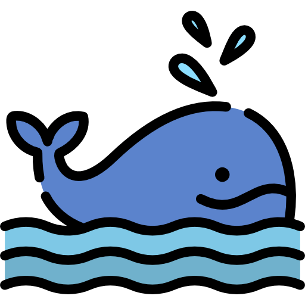
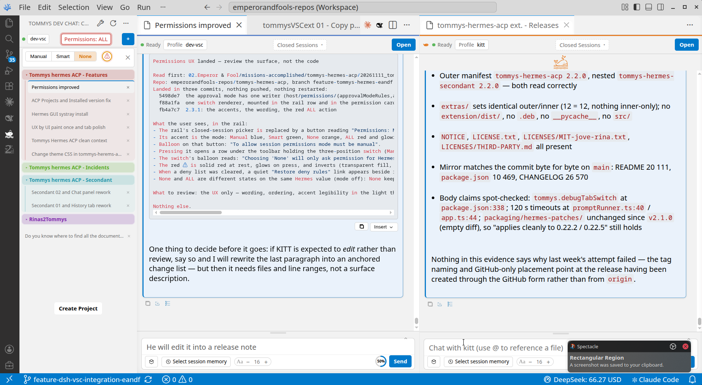

    <h1>Tommys Hermes ACP</h1> 
<strong><a href="https://hermes-agent.nousresearch.com">Hermes</a> in your editor, with memory across every conversation you have had with it. Pull any message from any session into your prompt, keep your tabs in projects, and put a second agent beside the first — with you as the gate between them.</strong>
 

---

> **TL;DR** — Session memory across every Hermes surface: TUI, dashboard, gateway, either pane.
> Projects that group your tabs and fold out of the way. Two agents on two profiles, handing
> each other work on your click. Steer a run while it runs.

## What this is

A VS Code / VSCodium extension that runs your local
[Hermes Agent](https://hermes-agent.nousresearch.com) inside the editor. It spawns
`hermes acp --profile <profile>` and speaks the
[Agent Client Protocol](https://agentclientprotocol.com) over stdio, so the agent you
already trust is the one doing the work.

The extension *is* the Hermes client. All credit to the people on the Hermes project — without
them there would be no co-operation with agents like this, and I would not have seen the
'lesser' models perform at the level the frontier corporate labs charge for.

Hermes keeps every conversation you have ever had with it, in whatever surface you had it. This
extension reads them all. Pick a session from the composer, tick the messages that matter, and
they arrive above your prompt as a quoted block — a conversation from the TUI, from the
dashboard, from the other pane. Your tabs sit in named projects that stay out of the way until
you switch into them.

A second agent can be installed from the primary extension's menu. A premium feature for free.
In the same VSCodium, each in its own panel or its own editor tab, they run side by side —
different profile, different session, different transcript, even a different model if you want.
You tab between them for a single view, or place them side by side for the full picture.

Personally I like the primary agent specialised on the current mission; the secondant researches,
drafts prompts and tracks the project with an overview. They can send messages to each other if
you like. Guarded by your click.

'Secondant' is Dutch (and French) for the 'second' in a classic wing-man relationship when
challenged. A fencer's _second_ stands beside the duellist as an equal with a different role.

That's the shape of this: two agents, their challenge, your call.

Enjoy the game!

Thomas Kai Tchong

<strong>Read more — what the extension does</strong>

<h2>Pull context from any conversation</h2>

Pick any of your sessions from the composer, read it in a throwaway tab, tick the
messages you want, and they arrive above your prompt as a quoted, attributed block.

<ul>
<li><strong>Every session Hermes knows</strong> — the viewer reads from Hermes rather than from a local
copy, so a conversation you had in the TUI, the dashboard or the gateway can be opened in either
pane in two clicks.</li>
<li><strong>Anchored, not pasted</strong> — the block points at message ids, so the quote stays faithful
even after the source conversation moves on.</li>
<li><strong>A pick belongs to its tab</strong> — context you staged for one thread cannot leak into
another. The current session is also offered: after a model switch the agent has lost
its context, and this tab's own earlier messages are exactly the memory worth
re-attaching.</li>
<li><strong>Choose the depth</strong> — a role filter on the attach bar lets you toggle User, Assistant,
Thought and Tool messages, so you can carry a question and its answer without dragging
forty tool calls along, or include the reasoning when you need it.</li>
<li><strong>Drawn as a card</strong> — an attached slice shows one bubble per message; a sent reply
redraws as the quote panel it was composed with.</li>
</ul>

<h2>Projects</h2>

A project is a named folder inside a workspace that groups tabs. Create one from the
<strong>Create Project</strong> button under the tab list, rename or delete it from the folder header,
and drag tabs into it. A tab started while a project is in use is born in that project.

<ul>
<li><strong>The tree folds for you.</strong> At start every project is open. From the first session
switch onwards the tree keeps the project you are working in open, plus the one you were in
before, and folds the rest. Fold or unfold by hand and the tree leaves it until the next
switch.</li>
<li><strong>Sticky tabs stay on top.</strong> <strong>Make It Sticky</strong> pins a tab above the rest;
<strong>Drop</strong> lets it go. Everything else stays newest-first.</li>
<li><strong>Projects are per profile.</strong> Each Hermes profile keeps its own project list, so the
primary and the secondant organise their own work.</li>
<li><strong>A second agent can read the tree.</strong> The current and passive trees are written to the
profile's storage, so an agent that needs the shape of your workspace can read it.</li>
</ul>

<h2>Two agents in one window</h2>

Install the companion from the primary's three-dot menu: <strong>Install secondant</strong>. A second,
independent agent appears. One install for you, two extensions on disk, nothing to configure
twice. <strong>Uninstall secondant</strong> takes it out again, version directories included; your
sessions stay in Hermes, so a reinstall brings them back.

<ul>
<li><strong>They cannot share a profile.</strong> Pointed at the profile the primary is using, the
secondant drops its connection, opens its picker and says why. Two agents means two
profiles, enforced rather than hoped for.</li>
<li><strong>You can tell them apart at a glance.</strong> The secondant carries an orange rule across its
toolbar and a badge row beneath it; in the editor-panel surface each pane's frame is
drawn in its own accent. The primary stays blue. Fencing colours.</li>
<li><strong>They can hand each other work.</strong> Forward any message from one pane to the other: it
arrives as a card with a sender pill and its body rendered as markdown, and nothing
reaches the receiving agent until you press <strong>Deliver</strong>. Consecutive forwards stack under
one rail with a single Deliver / Dismiss, sent as one turn in arrival order.</li>
<li><strong>Session memory crosses too.</strong> Forward a slice of any conversation and the receiving
agent gets the session handle, an anchor when no message ids matched, and a note that the
handle reads outside its own profile — along with the call that reads more of it.</li>
</ul>

The channel is a file under your Hermes home. No service, no port, no network: it carries
your own messages under your own permissions, and you sit in the middle of every hop. Let it run
a few rounds and you can watch, at human reading speed, how the two keep asking each other
questions and answering until both are satisfied within their role.

<h2>A tray for the backend</h2>

On Linux, <strong>Install Desktop GUI</strong> from the same menu puts a Hermes icon in your system
tray. Right-click shows whether the dashboard is up and on which port, and offers
<strong>Open Hermes GUI</strong>, <strong>Open VSCodium</strong>, <strong>Reload</strong> and <strong>Quit</strong>. It does not start on
login the way Hermes does by default; it sits in the tray for one-click access to the backend.
It is a separate program that ships inside the VSIX — the extension only launches its installer.
<strong>Uninstall Desktop GUI</strong> removes it.

<h2>Steer a run while it runs</h2>

With a turn in flight, type into the composer and <strong>Stop becomes Steer</strong>. Your words go
into the turn — not as a new question, not as cancel-and-retry — as guidance the agent
folds into what it is already doing. The transcript marks it with an orange <strong>Steer</strong> tag
that survives reload. The turn keeps its identity, its tool calls, its context.

<blockquote>

<strong>Roadmap:</strong> time-limited auto-approve while a steered turn runs, so you can say
"go ahead with the next three" without clicking a card for each one.

</blockquote>

<h2>Permissions</h2>

The rail shows the permission mode in force, once, as a button that wears its colour:
<strong>Manual</strong> blue, <strong>Smart</strong> green, <strong>None</strong> orange, <strong>ALL</strong> red and glowing. Press it and a
row opens under the toolbar with the three-position switch — the same switch the permission
card carries, drawn once and mounted twice so the two cannot disagree — plus a round red
warning button.

<ul>
<li><strong>None</strong> asks nothing, but the profile's own deny rules still block.</li>
<li><strong>ALL</strong> is the red button: it clears those rules, after saving them to a backup first, and
leaves a <strong>Restore deny rules</strong> link beside itself while the backup exists. A second press
stops it, even mid-flight, and resumes the mode it replaced. ALL is recorded, so a reload does
not change its mind; any deliberate mode choice ends it.</li>
<li><strong>The mode is read, not remembered.</strong> On window load and whenever the row opens, the pane
asks Hermes for the current mode — so a change made in a terminal shows up instead of being
contradicted.</li>
<li><strong>Gated commands say so.</strong> A command that passes an approval gate draws its note
("flagged … and auto-approved by smart approval") as its own card, not buried in the tool body.</li>
</ul>

<h2>The rest of the client</h2>

Sidebar or editor pane, your choice · tabs with rename and reopen · streaming markdown
with syntax highlighting · image paste and image-only prompts · <code>@</code> file mentions ·
send the editor selection as a prompt · transcript search, in the chat and in the viewer ·
multi-select copy, delete and export · session export as markdown · token meter · log
viewer · environment detection that finds a Hermes install and repairs <code>PATH</code> itself ·
resizable composer · English and Simplified Chinese throughout, including Hermes' own
permission wording.

<h2>Quieter touches</h2>
<ul>
<li><strong>The agent's structured questions render as forms</strong>, not as dead prompts.</li>
<li><strong>Consecutive tool calls fold into one card</strong>, so a dozen reads do not bury the answer.</li>
<li><strong>Thoughts and tool cards grow with the text while live</strong>, then collapse to a readable
cap when the turn finishes — so you can follow reasoning as it arrives without it
pushing the answer off-screen afterwards.</li>
<li><strong>Loading looks deliberate</strong> — the pane's own icon, pulsing, with a live count of the
messages arriving from Hermes beneath it.</li>
<li><strong>A message Hermes never received is caught</strong> — the last few user turns live in a small
sidecar, and the agent's replay is checked against it before the transcript is replaced. When
a send genuinely died between the pane and the agent, a notice offers <strong>Restore</strong> or
<strong>Discard</strong>. Nothing is pre-filled.</li>
<li><strong>Closed sessions leave nothing behind</strong> — closing a tab cleans up its local copy, so the
local store stays a working copy of what is open, and no more.</li>
</ul>

## Who this is for

Not people shopping for an AI assistant in the abstract. People who have already chosen
Hermes, work across more than one conversation at a time, and want the
editing-while-it-runs rhythm that most clients make you fight for.

<strong>Requirements, settings and install</strong>

<h2>Requirements</h2>
<ul>
<li>VS Code 1.85+ or VSCodium (this is developed against VSCodium)</li>
<li><a href="https://hermes-agent.nousresearch.com">Hermes Agent</a> installed and configured</li>
<li><code>hermes</code> on <code>PATH</code>, or <code>tommys.path</code> set in settings</li>
<li>For the secondant: a <strong>second Hermes profile</strong>, because the two panes may not share one</li>
<li>For the Desktop GUI: Linux. Tested on Ubuntu 24.04</li>
<li>The <strong>Hermes ACP patch</strong>, applied to your Hermes install — see <em>Important: the Hermes patch</em> below. Without it the tab list cannot see hidden sessions, closing a tab leaves it listed, and renames do not stick</li>
</ul>
<h2>Important: the Hermes patch</h2>

<strong>Apply this before anything else.</strong> The extension uses three ACP extension methods that upstream Hermes does not ship yet:

<ul>
<li><code>_session/catalog</code> — every session, hidden ones included, with its hidden flag</li>
<li><code>_session/setHidden</code> — hide or unhide a session, which is what closing a tab does</li>
<li><code>_session/setTitle</code> — rename a session as a user title</li>
</ul>

Without them the sidebar cannot see sessions you have closed, a closed tab stays listed, and renaming a conversation does not survive. They are added by two patches, kept in this repository until they land upstream:

<pre><code class="language-bash">cd ~/.hermes/hermes-agent
git apply --3way /path/to/tommys-hermes-acp/packaging/hermes-patches/0001-acp-session-catalog-hidden-title.patch
git apply --3way /path/to/tommys-hermes-acp/packaging/hermes-patches/0002-acp-gateway-ext-methods.patch
</code></pre>

<code>0001</code> adds the three methods (base <code>0.22.2</code>, and it reads the session table in either layout — <code>source</code> on 0.22.2, <code>created_source</code> on 0.22.5, where <code>source</code> is rewritten to <code>local</code>); <code>0002</code> carries them onto <code>GatewayACPAgent</code>, the class <code>0.22.5</code> actually answers from, because <code>HermesACPAgent</code>&rsquo;s <code>__new__</code> returns one. On <code>0.22.5</code> and later both are required &mdash; <code>0001</code> alone still applies cleanly and changes nothing, which is what makes the failure quiet. They touch only <code>acp_adapter/server.py</code>, <code>acp_adapter/session.py</code> and <code>acp_adapter/gateway_server.py</code>, and only call Hermes&rsquo; own database methods. Re-apply both after any <code>hermes update</code> that drops them; <code>packaging/hermes-patches/CHANGELOG.md</code> records the bases and the symptom when one is missing.

<em>Tested on Ubuntu 24.04. Windows is untested &mdash; both the Hermes install location and <code>git apply</code> behave differently there. If you try it, please open an issue and say what happened; this section will then state it honestly rather than guess.</em>

<h2>Build and install</h2>
<pre><code class="language-bash">npm install
npm run package                                     # compile + bundle the pane + vsix
codium --install-extension ./tommys-hermes-acp-&lt;version&gt;.vsix --force
</code></pre>

<code>npm run package</code> bundles the secondant VSIX and the Desktop GUI inside the primary.
<code>npm run package:secondant</code> builds the companion on its own; users never need it, because
the primary installs it from the menu.

<code>npm run deploy</code> is the fast path while developing: it compiles, rebuilds the pane bundle
and copies everything into the installed extension directory, verifying each file by hash.

Extension ids: <code>emperorandfool.tommys-hermes-acp</code> and
<code>emperorandfool.tommys-hermes-secondant</code>.

<h2>Settings</h2>
<table>
<thead>
<tr>
<th>Setting</th>
<th>Description</th>
<th>Default</th>
</tr>
</thead>
<tbody><tr>
<td><code>tommys.path</code></td>
<td>Path to the Hermes executable</td>
<td>auto-detect</td>
</tr>
<tr>
<td><code>tommys.cwd</code></td>
<td>Working directory for sessions</td>
<td>workspace root</td>
</tr>
<tr>
<td><code>tommys.profile</code></td>
<td>Hermes profile name</td>
<td><code>default</code></td>
</tr>
<tr>
<td><code>tommys.showThoughts</code></td>
<td>Show agent reasoning</td>
<td><code>true</code></td>
</tr>
<tr>
<td><code>tommys.showToolCalls</code></td>
<td>Show tool-call notifications</td>
<td><code>true</code></td>
</tr>
<tr>
<td><code>tommys.chatSurface</code></td>
<td><code>sidebar</code> or <code>editor</code></td>
<td><code>sidebar</code></td>
</tr>
<tr>
<td><code>tommys.models</code></td>
<td>Fallback model list</td>
<td><code>[]</code></td>
</tr>
<tr>
<td><code>tommys.defaultModel</code></td>
<td>Default model id (fallback list only)</td>
<td><code>""</code></td>
</tr>
<tr>
<td><code>tommys.agents</code></td>
<td>Named agent configurations</td>
<td><code>[]</code></td>
</tr>
</tbody></table>

The secondant exposes the same keys under <code>tommys2.*</code>.

<pre><code class="language-json">"tommys.agents": [
  { "name": "Default", "profile": "" },
  { "name": "Fast", "path": "/path/to/hermes", "profile": "fast" }
]
</code></pre>

The composer's <code>Aa</code> pill sets the transcript font size (10–28 px) and remembers it.

## Use

1. Click the **Tommys Dev Chat** icon in the activity bar, or run **Hermes: Open Chat**.
2. Wait for status **Ready**, then type. **Enter** sends, **Shift+Enter** adds a line.
3. `@` references a workspace file; clicking a path in a reply opens it in the editor.
4. **+** starts a conversation; each tab keeps its own transcript. **Create Project** under the
   tab list groups tabs into a folder; drag tabs in.
5. **Select session memory** on the composer opens any session Hermes knows; tick messages
   and they are quoted above your prompt.
6. To steer, keep typing while a turn runs — the button tells you what it will do.
7. For a second agent, open the three-dot menu and run **Install secondant**. It appears as a
   second activity-bar container with its own orange accent. **Uninstall secondant** takes
   it out again, version directories included.
8. On Linux, **Install Desktop GUI** from the same menu adds the Hermes tray icon.

> Opening a tab for a session Hermes knows resumes it over ACP (`session/load`), and the
> transcript arrives from Hermes itself — nothing is read back from a local copy.

## Troubleshooting

| Symptom | What to try |
|---|---|
| Stuck on **Connecting…** | Environment menu → detection; ensure `hermes` is on `PATH` or set `tommys.path` |
| **ACP dependencies missing** | Run `hermes acp --check` in a terminal |
| No reply on the first message | Normal — Hermes may load plugins on the first turn |
| Model not listed | Add entries under `tommys.models` |
| An activity-bar icon is missing after an upgrade | Hide, then show the container from the activity-bar context menu |
| Secondant disconnected itself | It is on the primary's profile. Pick another from its profile dropdown |
| Secondant installed but not visible | Reload the window; the registry only lists it after a reload |
| Forward button missing | The other pane is not running — the two panes announce themselves with a heartbeat |
| Permission mode shows the wrong value | Open the permission row; it re-reads the mode from Hermes |
| Need to see what Hermes sends over ACP | Launch the editor with `HERMES_ACP_TRACE=1`; each `session/update` goes to the OutputChannel and to `~/.hermes/pane-mail/trace-<profile>.ndjson` |

## Known issues

- **Thought segment heuristic** — the pane uses a prefix test to decide whether a thought
  chunk continues the current card or starts a new one. If a genuinely new segment opens
  with the same text as the end of the previous one, it is treated as a continuation.
  Cannot be fixed without the host marking segment boundaries. Very rare in practice.
- **Anchor quotes are truncated** — a forwarded session slice whose message ids did not
  match is anchored on its opening words, clipped at a fixed length. A prefix search finds
  them; a strict search for the whole quote will not.
- **Long transcripts are not virtualised** — every message in a tab is a live DOM node. Fine
  for ordinary sessions, slow on transcripts of several thousand messages.
- **Windows is untested** — the Hermes install location, `git apply` and the Desktop GUI all
  behave differently there.

## FAQ

**Will this be maintained?** The code is split by runtime — `src/host` (VS Code, filesystem,
CLI, ACP), `src/pane` (the webview), `src/shared` (the message contract) — with both
directions of the protocol typed as unions, so a message added on one side fails to compile
on the other. The test suite covers the host side; the pane is bundled by esbuild.

**Is this the upstream project?** No. This project originated from
[Rina Hermes ACP](https://github.com/jove-rina/rina-hermes-acp) (MIT, © 2026 jove-rina)
and continues independently under its own extension identity. It is not endorsed by
upstream. Provenance is in [`NOTICE`](NOTICE).

**Does it work with plain VS Code?** Yes, 1.85 or newer. VSCodium is what it is developed
against.

**What changed in 2.x?** 2.0 gave the extension a second, independent agent beside the first,
and took away the local copy of the conversation it had been keeping since the fork — the
transcript now comes from Hermes, with a small sidecar for the one case Hermes cannot cover.
2.1 added the Hermes patch and the Desktop GUI. 2.3 added projects and the permission rail.
See [`CHANGELOG.md`](CHANGELOG.md) for each release.

**How far is this from the upstream?** v1.0.0 started with image paste, theming fixes
and a font-size pill on top of upstream 0.3.2. Since then the codebase has been restructured
into host/pane/shared runtimes, the protocol is fully typed, and the features above — the
secondant, pane mail, projects, steer, history attach with role filter, the permission rail,
live card sizing, transcript reconciliation, elicitation forms, environment detection, the
Desktop GUI, i18n — are all new work. The upstream MIT notice is retained in full; see Licence
below.

**Roadmap**

- **Time-limited approve-all** — approve the next N tool calls or approve for the next M
  minutes, so a steered turn doesn't need a click for every step.
- **Virtualised transcripts** — render a window of messages rather than all of them, so a
  session with thousands of turns scrolls as smoothly as a short one.
- **An agent-callable forward** — let an agent propose something for the other pane, with
  the same Deliver gate in front of it.
- **Hermes upstream PR** — contribute the ACP session catalog, hidden and title methods
  back to Hermes as a proper pull request.

## Licence and attribution

**This project is distributed under GPL-3.0-or-later**, © 2026 Emperor & Fool — full text in
[`LICENSE`](LICENSE). It originated from Rina Hermes ACP, received under the **MIT**
licence, © 2026 jove-rina; that notice is retained verbatim in
[`LICENSES/MIT-jove-rina.txt`](LICENSES/MIT-jove-rina.txt) as MIT requires, and the upstream
code remains available from upstream under MIT. The full split, the upstream commits this
fork is based on, and the bundled third-party licences are in [`NOTICE`](NOTICE) and
[`packaging/copyright`](packaging/copyright).

Because this is a GPL work: the complete source for every distributed build is this
repository, and anyone redistributing a modified version must do so under the same licence.

Bundled components keep their own licences: `@agentclientprotocol/sdk` and
`media/vendor/purify.min.js` (DOMPurify) Apache-2.0; `media/vendor/highlight.min.js` and
`github-dark.min.css` (highlight.js) BSD-3-Clause; `media/vendor/marked.min.js` MIT.

Neither MIT nor the GPL grant trademark rights: the upstream name "Rina Hermes ACP", the
`jove-rina` name and the upstream marketplace identity are not used by this project.

**The artwork is not ours, and the GPL does not cover it.** The whale under `media/` —
`icon.png`, `icon.svg`, `icon_fullcolor.png`, `icon_orange.svg`, `icon_SECONDANT.svg` — and
the activity-bar glyph `activitybar.svg` are *designed by Magnific from Flaticon*, used under
the [Flaticon Free License](https://media.flaticon.com/license/license.pdf). That licence
requires attribution, permits recolouring and derivative works, and does not permit
sublicensing or redistributing the artwork on its own. So it is excluded from the GPL grant
above: you may redistribute this extension, not the artwork separately, and you may not
relicense it.
